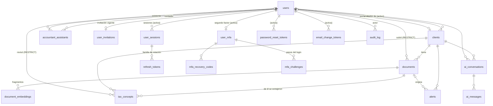

# Modelo de dominio

Qué representa la plataforma, quién hace qué, cómo cambia cada cosa en el tiempo y qué reglas no
se pueden romper (y quién las hace cumplir: la **base** o la **API**). Refleja el esquema hasta
la migración `026_concept_review.sql`.

`docs/erd.png` es el diagrama del esquema inicial (001–009). El diagrama de abajo está al día y
vive en texto para que cambie junto con las migraciones.

## 1. El problema en una frase

Un **contador** lleva la declaración de renta de sus **clientes**. Sube sus **documentos**
(certificados, extractos, facturas); la IA extrae los **conceptos tributarios** (ingresos,
retenciones, deducciones…). Una persona los **revisa** contra el original, las reglas generan
**alertas** y un chat responde preguntas sobre cada cliente con sus propios documentos.

## 2. Actores (roles)

| Rol                                | Quién es                                     | Qué puede hacer                                                                                                                                                    |
| ---------------------------------- | -------------------------------------------- | ------------------------------------------------------------------------------------------------------------------------------------------------------------------ |
| `accountant` (contador)            | Profesional dueño de una cartera de clientes | Todo sobre **sus** clientes: crearlos, subir documentos, ver el original, revisar conceptos, gestionar alertas, usar la IA                                         |
| `assistant` (asistente)            | Trabaja para **un** contador                 | Lo mismo que su contador sobre los clientes de ese contador, salvo **crear o borrar** clientes                                                                     |
| `client` (contribuyente, "portal") | La persona cuya declaración se gestiona      | **Solo lectura** de su propio expediente: documentos (descarga), conceptos (solo si están revisados o no) y alertas. No usa la IA                                  |
| `admin`                            | Administra la plataforma                     | Invita cuentas, reasigna clientes entre contadores, restablece el MFA de otros, consulta la auditoría y el rendimiento. Ve todos los clientes. **MFA obligatoria** |

Matriz detallada de permisos por ruta: `renta-ia-backend/src/middlewares/role.middleware.ts` (la
garantía) y `renta-ia-frontend/src/auth/permissions.js` (qué muestra la interfaz).

Visor del original y vista dividida (B17-B18): solo `accountant` y `assistant`. El contribuyente y
el admin descargan el archivo.

## 3. Entidades y relaciones



"(activa)" significa que la relación solo puede existir con una cuenta `active`: la FK compuesta
`(user_id, user_status) → users (id, status)`, con `CHECK (user_status = 'active')`. Ver la §5.

| Entidad                                              | Qué es                                                                            | Notas                                                                                                            |
| ---------------------------------------------------- | --------------------------------------------------------------------------------- | ---------------------------------------------------------------------------------------------------------------- |
| `users`                                              | Una cuenta, de cualquier rol                                                      | Estado `invited` → `active` → `deleted`. Perfil: teléfono, foto, densidad de las tablas                          |
| `clients`                                            | Un contribuyente cuya declaración se gestiona                                     | Pertenece a **un** contador activo; puede tener **un** usuario de portal. Número de documento único por contador |
| `accountant_assistants`                              | Qué asistente trabaja para qué contador                                           | Se crea al invitar al asistente                                                                                  |
| `documents`                                          | Un archivo subido de un cliente (metadatos; el archivo vive en el almacenamiento) | Estado `uploaded` → `processing` → `processed`/`error`. SHA-256 único por cliente (no se sube dos veces)         |
| `tax_concepts`                                       | Una cifra tributaria extraída de un documento                                     | Monto vigente, **lo que leyó la IA** (`ai_amount`), fuente (`ai`/`person`), quién y cuándo lo revisó             |
| `document_embeddings`                                | Fragmentos vectorizados del texto, para el chat (RAG)                             | Siempre filtrados por cliente                                                                                    |
| `alerts`                                             | Vencimiento o inconsistencia de un cliente                                        | `open` → `acknowledged` → `resolved`; una sin resolver por situación (`dedupe_key`)                              |
| `ai_conversations` / `ai_messages`                   | Historial del chat por cliente y usuario                                          |                                                                                                                  |
| `user_invitations`                                   | La invitación vigente de una cuenta pendiente                                     | Solo el hash del token; 72 h; una vigente por cuenta                                                             |
| `user_sessions` / `refresh_tokens`                   | Una sesión (equipo) y su familia de tokens rotativos                              | IP recortada, ubicación aproximada, equipo                                                                       |
| `user_mfa` / `mfa_recovery_codes` / `mfa_challenges` | Segundo factor TOTP                                                               | Secreto **cifrado**; códigos de recuperación solo como hash; paso del login de 5 min y 5 intentos                |
| `password_reset_tokens` / `email_change_tokens`      | Enlaces de recuperación (15 min) y de cambio de correo (24 h)                     | Solo el hash; uno vigente por cuenta                                                                             |
| `email_outbox`                                       | Correos enviados (con el proveedor simulado, también su cuerpo)                   | El cuerpo solo se guarda con el proveedor simulado                                                               |
| `audit_log`                                          | Quién hizo qué, sobre qué y cuándo                                                | Sin datos sensibles; 12 meses                                                                                    |
| `web_vitals`                                         | Métricas de experiencia real (RUM)                                                | Anónimas                                                                                                         |
| `login_attempts`                                     | Fallos de login por cuenta (clave = SHA-256 del correo)                           | Bloqueo progresivo                                                                                               |

## 4. Ciclos de vida

### Cuenta

```
            invitar (admin)            activar con su contraseña
 (nada) ───────────────────▶ invited ──────────────────────────▶ active ──── eliminar ────▶ deleted
                               │  sin contraseña, sin sesiones          (lápida anónima: sin nombre,
                               │  cancelar → se borra                     correo, teléfono, foto ni
                               ▼                                          contraseña; la fila sigue)
```

- No hay registro público: toda cuenta nace **por invitación** (B5).
- Un contador con clientes no puede pasar a `deleted`: primero se **reasignan** sus clientes a
  otro contador (todos, en una transacción).
- El único admin activo no puede eliminarse.

### Documento y conceptos

```
 subir ──▶ uploaded ──▶ processing ──▶ processed  (con o sin advertencias)
                                   └─▶ error      (p. ej. PDF escaneado sin texto)
                              ▲
                              └── reprocesar (solo si terminó). Si tiene conceptos REVISADOS:
                                  409 salvo confirmación explícita "descartar revisiones" (D6)
```

Cada concepto extraído nace **"Extraído por IA · sin revisar"** (`source = ai`,
`reviewed_at = NULL`, `ai_amount = amount`). Al revisarlo:

- se confirma el mismo monto → sigue `source = ai`, queda revisado;
- se corrige → `source = person`, queda revisado. `ai_amount` **nunca cambia**: lo que leyó la IA
  queda a la vista.

### Sesión

Iniciar sesión crea una **sesión** y su primer refresh token. Cada renovación rota el token
dentro de la misma familia. Reutilizar uno ya rotado revoca la familia. Cerrar sesión, cerrar
"las demás", restablecer la contraseña o activar MFA revocan sesiones, y cada petición comprueba
que la suya siga viva.

## 5. Reglas del dominio y quién las hace cumplir

| Regla                                                                                               | La base                                                                                                | La API                                                                           |
| --------------------------------------------------------------------------------------------------- | ------------------------------------------------------------------------------------------------------ | -------------------------------------------------------------------------------- |
| Una cuenta pendiente no tiene contraseña ni sesiones, tokens o MFA                                  | `chk_users_password_by_status`; FK compuesta a `users (id, status)` en cada tabla "de cuenta activa"   | no las crea                                                                      |
| Cada cliente tiene un contador **activo**                                                           | `fk_clients_active_accountant` (FK `(accountant_user_id, accountant_status)`)                          | reasignar antes de eliminar                                                      |
| Un contador ve solo sus clientes; su asistente, los de su contador; el portal, su expediente        | —                                                                                                      | `clientScope` (404 a lo ajeno)                                                   |
| Lo que subió o revisó una cuenta no se borra con ella                                               | `documents.uploaded_by` y `tax_concepts.reviewed_by` `ON DELETE RESTRICT`; la cuenta queda como lápida | —                                                                                |
| Lápida sin datos personales                                                                         | `chk_users_deleted_scrubbed`, `chk_users_deleted_at`                                                   | —                                                                                |
| "De la IA" ⇒ el monto es el que leyó la IA; corregido ⇒ revisado; revisión con autor y fecha juntos | `chk_tax_concepts_ai_amount_kept`, `chk_tax_concepts_person_reviewed`, `chk_tax_concepts_review_pair`  | —                                                                                |
| Lo que leyó la IA se guarda siempre                                                                 | trigger `trg_tax_concepts_ai_amount`                                                                   | la revisión no lo modifica                                                       |
| Reprocesar no borra revisiones sin confirmación                                                     | —                                                                                                      | 409 `reviewed_concepts`; el worker solo las reemplaza con `discardReviews`       |
| Enlaces de un solo uso, con vigencia máxima, uno vigente por cuenta                                 | CHECK de vigencia, índices únicos parciales, solo `token_hash`                                         | firma, uso único y revocación                                                    |
| Secreto MFA solo cifrado                                                                            | `chk_user_mfa_ciphertext_format`                                                                       | AES-256-GCM con `MFA_ENCRYPTION_KEY`                                             |
| Nunca la IP completa de una sesión                                                                  | `chk_user_sessions_ip_prefix`                                                                          | recorta a /24 (IPv4) o /48 (IPv6)                                                |
| La foto de una cuenta vive bajo su propia carpeta                                                   | `chk_users_avatar_key_owner`, `chk_users_avatar_key_format`                                            | —                                                                                |
| Una alerta sin resolver por situación                                                               | índice único parcial `uq_alerts_active_dedupe`                                                         | —                                                                                |
| El mismo archivo no se sube dos veces al mismo cliente                                              | `uq_documents_client_sha256`                                                                           | dedupe antes de encolar                                                          |
| El contribuyente solo sabe si un concepto está revisado                                             | —                                                                                                      | la API no le envía quién, lo que leyó la IA, la fuente ni el documento de origen |
| MFA obligatoria para admin                                                                          | —                                                                                                      | sin MFA, la API solo le deja activarla                                           |

Las pruebas que intentan romper cada regla de la base con SQL directo están en
`renta-ia-backend/tests/integration/` (`accountStatus`, `passwordReset`, `mfa`, `profile`,
`avatar`, `userSessions`, `accountData`, `conceptReview`). El detalle de cada restricción está en
el [README](../README.md#cuentas-pendientes-garantías-del-esquema-migración-017).

## 6. Glosario

| Término                | Significado                                                                                             |
| ---------------------- | ------------------------------------------------------------------------------------------------------- |
| Expediente             | Todo lo de un cliente: documentos, conceptos, alertas y conversaciones                                  |
| Concepto tributario    | Una cifra con tipo (ingreso bruto, retención, deducción, aporte a pensión o salud, otro) y año gravable |
| Revisado / sin revisar | Si una persona ya confirmó o corrigió lo que extrajo la IA                                              |
| Original               | El archivo tal como se subió (se ve en el visor o se descarga)                                          |
| Vista dividida         | El original junto a los conceptos de ese documento, para revisarlos                                     |
| Lápida                 | La fila de una cuenta eliminada: sin datos personales, para que su historial siga teniendo autor        |
| Reasignar              | Pasar todos los clientes de un contador a otro                                                          |
